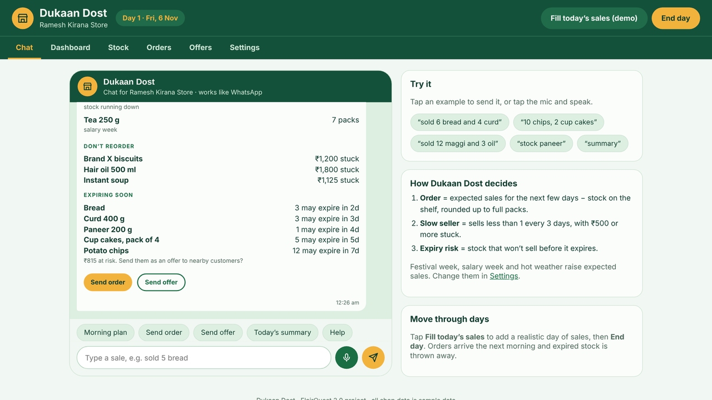

# Dukaan Dost – smart stock assistant for kirana stores

**FlairQuest 2.0 Ideathon · Track 04: Next-Gen Retail & Supply Chain Intelligence**
Team: [Team name]

Kirana stores still sell most of India’s groceries, but owners decide what to stock from memory. That leads to dead stock, empty shelves, expired goods and cash stuck on shelves. Dukaan Dost is a WhatsApp-style assistant that tells the owner **what to order, what to stop ordering and what is about to expire**, and lets them act with one tap.



---

## How to run it

1. Unzip the folder.
2. Double-click **`index.html`**. It opens in Chrome or Edge.

That’s it: no install, no npm, no server. It also works offline (the fonts just fall back to a system font).
Everything you do is saved in the browser, so it’s still there after you close the tab. **Settings → Reset demo data** starts again from Day 1.

---

## What it does

| Section | What you can do |
|---|---|
| **Chat** | Talk to Dukaan Dost like on WhatsApp. Send sales as a typed or spoken voice note (*“sold 6 bread and 4 curd”*), ask *“stock paneer”*, get the **morning plan**, and tap **Send order** / **Send offer**. |
| **Dashboard** | Today’s sales, money stuck in slow stock, items to reorder, value at risk of expiring, a 7-day sales chart and this week’s demand boosts. |
| **Stock** | All products with stock, daily sales, expected sales, expiry and status. Search, add, edit and delete products. |
| **Orders** | Today’s suggested order, one-tap send, **Open in WhatsApp** (a real WhatsApp message to the distributor), order history and deliveries. |
| **Offers** | Items at risk of expiring with a discount, the **customer view** (customers pick items and reserve), pickup codes and “picked up” tracking. |
| **Settings** | Festival week / salary week / hot weather switches, discount %, shop details, download data as JSON, reset. |

**Move through days:** tap **Fill today’s sales (demo)** to add a realistic day of sales, then **End day**. Yesterday’s order arrives, expired stock is thrown away and logged, and a new morning plan appears.

---

## How the engine decides

All decisions come from three simple, explainable rules in `js/engine.js`:

1. **Order** = expected sales for the next few days − stock on the shelf, rounded up to full packs.
2. **Slow seller** = sells less than about 1 every 3 days **and** ₹500 or more is stuck on the shelf → don’t reorder.
3. **Expiry risk** = stock that probably won’t sell before it expires → offer it to nearby customers at a discount.

**Expected sales** = average daily sales (last 7 days) × days ahead × this week’s boosts
(festival week: festival items ×1.6, snacks ×1.15 · salary week: staples ×1.25 · hot weather: drinks ×1.4).

**Example (Maggi noodles):** average 10.4 a day × 7 days × 1.15 (festival snacks) ≈ 84 expected. 30 on the shelf → 54 more needed → a carton holds 48 → **order 2 cartons**.

---

## Dukaan Dost on real WhatsApp

The `whatsapp-bot/` folder is a real WhatsApp bot that uses the same engine. Owners can type or send voice notes in any Indian language and get replies in that language, with tap buttons. It uses Meta’s WhatsApp Cloud API and Google Gemini, needs no npm packages, and runs free on Render. Setup steps are in [`whatsapp-bot/README.md`](whatsapp-bot/README.md).

## Project structure

```
dukaan-dost/
├── index.html          the page: header, tabs and the place each section is drawn
├── css/style.css       look and feel (green + amber theme, works on phone and laptop)
├── js/data.js          sample shop data and the starting state
├── js/engine.js        the decision engine (forecast, order, slow seller, expiry risk, voice-note reader, end of day)
├── js/store.js         saving and loading data in the browser (localStorage)
├── js/app.js           all screens and buttons
├── screenshots/        pictures of each screen
└── tests/test_app.py   automated end-to-end test in Chrome (optional)
```

## Tech stack

- **HTML, CSS and plain JavaScript**: no frameworks, no build step, so it runs anywhere by double-click.
- **localStorage** to save data in the browser.
- **Web Speech API** for voice notes (Chrome/Edge, when the microphone is allowed).
- **WhatsApp click-to-chat links** (`wa.me`) to send real order and offer messages.
- **Playwright** (Python) for the automated test.

## Testing

`tests/test_app.py` opens the app in Chrome and checks 28 things end to end: the morning plan, typed sales, dashboard numbers, week switches changing the order, sending orders and WhatsApp links, offers, customer reservations and pickups, adding/searching/deleting products, number words (“two”), “hair oil” vs “oil”, ending a day with deliveries, saving after reload, phone layout and reset.

```
pip install playwright
playwright install chromium
python tests/test_app.py
```

## Limitations of this version

- Runs on **sample data** in one browser. The real product would keep data on a server.
- WhatsApp is **simulated** inside the app; the real product needs the WhatsApp Business API (Meta approval). The “Open in WhatsApp” links already send real messages.
- Voice notes depend on the browser. If the microphone is blocked when the page is opened as a file, type the sale instead.
- Each fresh product is treated as one batch with one expiry date.
- Forecasts use simple rules, not machine learning yet.

## Future scope

- Pilot with real kirana stores near campus and replace the rules with machine-learning forecasts.
- WhatsApp Business API, voice notes in Hindi, Telugu and other languages, bill-photo reading (OCR).
- Sync sales automatically from UPI or billing apps.
- Distributor dashboard and tie-ups; anonymised demand trends for FMCG brands.

---

*All shop names, products, prices and sales in this project are sample data.*
